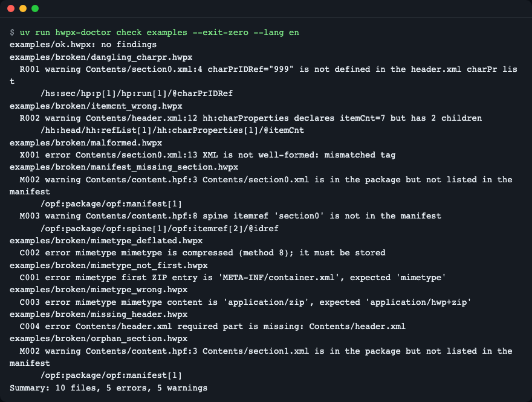
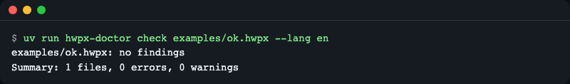
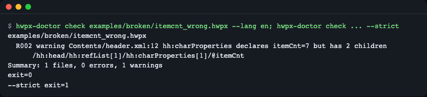
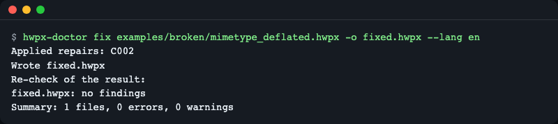
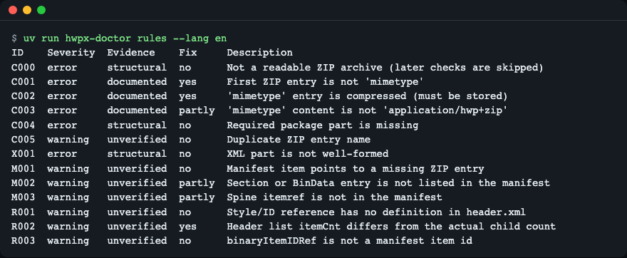
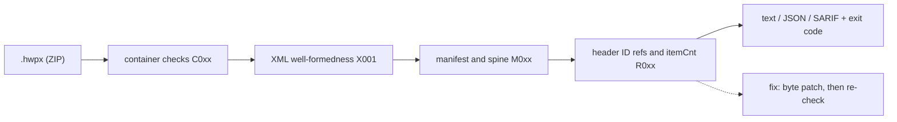

# hwpx-doctor

[한국어](README.md) | **English**

A dependency-free CLI and Python library that checks generated HWPX (OWPML) files for container, manifest and ID-reference defects, and safely repairs the mechanical ones. Run it in CI, pre-commit, or an agent loop after a converter or script writes a `.hwpx`. Install: `uv tool install git+https://github.com/LeeGyeongPil/hwpx-doctor`, run: `hwpx-doctor check out.hwpx`.


*One good file and nine broken ones checked. You get rule IDs, part:line locations and a summary line.*

## Who it is for
- You build a converter or script that writes HWPX and want CI to catch broken output.
- An LLM or agent writes `.hwpx` and you want a mechanical filter before a human opens it.
- You want container, manifest and ID-reference problems with line numbers, without opening Hancom Office.

## Install
```bash
# if you do not have uv (macOS, Linux)
curl -LsSf https://astral.sh/uv/install.sh | sh

uv tool install git+https://github.com/LeeGyeongPil/hwpx-doctor
```
Python 3.10+ is required. There are no runtime dependencies (standard library only). To use it as a library, add it to your project (`uv add git+https://github.com/LeeGyeongPil/hwpx-doctor` or `pip install git+https://github.com/LeeGyeongPil/hwpx-doctor`) and `import hwpx_doctor`. Once installed, run `hwpx-doctor check out.hwpx` on your own files.

## Quick start
The example files live only inside the repo, so clone it first.
```bash
git clone https://github.com/LeeGyeongPil/hwpx-doctor
cd hwpx-doctor
uv run hwpx-doctor check examples --exit-zero --lang en
```
`examples/` has one good file and nine broken ones. The last line of the output is:
```
Summary: 10 files, 5 errors, 5 warnings
```
- The first column such as `R001` is the **rule ID**, then the severity, then `part:line`. The line below is the location inside the XML.
- `--exit-zero` keeps the exit code at 0 even when there are findings. It is here for the demo; drop it in CI so failures propagate.

A good file looks like this.


*With no findings it prints just the file line and the summary line.*

## Usage
| Command / option | What it does | Example |
|---|---|---|
| `check PATH...` | Check `.hwpx` files or folders (recursive) | `hwpx-doctor check out.hwpx` |
| `--format text\|json\|sarif` | Output format (JSON/SARIF keys and rule IDs are language-independent) | `--format sarif` |
| `--select` / `--ignore` | Run or skip rules by ID or prefix | `--select C,R001`, `--ignore R` |
| `--strict` | Treat warnings as failures (exit 1) | `check a.hwpx --strict` |
| `--exit-zero` | Exit 0 even with findings (usage errors stay 2) | `check . --exit-zero` |
| `fix IN -o OUT` | Apply safe repairs, then re-check (`--in-place`, `--force` also exist) | `fix a.hwpx -o a.fixed.hwpx` |
| `rules` | List rules and their evidence level | `hwpx-doctor rules` |
| `--lang en\|ko` | Output language | `--lang en` |

**Exit codes**: 0 = no failing findings, 1 = failing findings, 2 = usage or input error (e.g. missing path).

### Scenario 1 — a warning-only file, gated in CI
This file has an `itemCnt` (list count attribute) that disagrees with the real count. By default it is a warning (exit 0); with `--strict` the exit code becomes 1.


*The same file with default settings and with `--strict`.*

Rules whose failure to open in Hancom Office has not been confirmed (evidence level `unverified`) default to warnings. Use `--strict` if your team wants to block on them.

### Scenario 2 — fix a mechanical defect
A file whose `mimetype` entry is compressed (C002) only needs to be stored uncompressed. `fix` never modifies the input; it writes a new file and re-checks it right away.


*The re-check after the repair shows no findings.*

Defects whose repair would change meaning, such as a dangling `charPrIDRef`, are not fixed; they are reported as "left as is". Running `fix` on a fixed result again produces identical bytes. If the output file exists, `fix` stops with exit code 2 unless you pass `--force`.

### Scenario 3 — wire it into CI or pre-commit
A GitHub Actions example (a configuration sketch, not something this repo executes):
```yaml
- run: uv tool install git+https://github.com/LeeGyeongPil/hwpx-doctor
- run: hwpx-doctor check build/ --format sarif > hwpx-doctor.sarif || true
- uses: github/codeql-action/upload-sarif@v3   # upload to code scanning (sketch, not verified here; the job needs `permissions: security-events: write`)
  with:
    sarif_file: hwpx-doctor.sarif
- run: hwpx-doctor check build/ --strict
```
`--format json` output looks like this (the `message` text follows the output language, `--lang`) (part of a real run):
```json
{
  "tool": "hwpx-doctor",
  "version": "0.1.0",
  "files": [
    {
      "file": "examples/broken/malformed.hwpx",
      "findings": [
        { "rule": "X001", "severity": "error", "part": "Contents/section0.xml", "path": "", "line": 13, "message": "XML is not well-formed: mismatched tag" }
      ]
    }
  ],
  "summary": { "files": 1, "errors": 1, "warnings": 0 }
}
```
The repo defines a `hwpx-doctor` hook in `.pre-commit-hooks.yaml` (configuration sketch):
```yaml
repos:
  - repo: https://github.com/LeeGyeongPil/hwpx-doctor
    rev: v0.1.0
    hooks:
      - id: hwpx-doctor
```

### Scenario 4 — call it from Python
Public API: `check`, `fix`, `RULES`, `Finding`, `Report`, `FixResult`, `InputError`. Call it from generator code like this (run and verified):
```python
from hwpx_doctor import check

report = check("examples/broken/itemcnt_wrong.hwpx")
print([f.rule for f in report.findings])  # ['R002']
print(report.failed())                    # False (warnings only)
print(report.failed(strict=True))         # True
```
Input errors such as a missing path raise `InputError`.

## Configuration
| Name | Default | Description |
|---|---|---|
| `--lang en\|ko` | resolved from environment | highest priority |
| `HWPX_DOCTOR_LANG` | unset | `en` or `ko` |
| `LC_ALL` > `LC_MESSAGES` > `LANG` | system | anything not starting with `ko` means English |

Priority: `--lang` > `HWPX_DOCTOR_LANG` > `LC_ALL` > `LC_MESSAGES` > `LANG`. No keys, network or config files are needed. The full rule list:

| ID | Severity | Evidence | Fix | Description |
|---|---|---|---|---|
| C000 | error | structural | no | Cannot be opened as a ZIP (later checks skipped) |
| C001 | error | documented | yes | First ZIP entry is not `mimetype` |
| C002 | error | documented | yes | `mimetype` entry is compressed |
| C003 | error | documented | partly | `mimetype` content is not `application/hwp+zip` |
| C004 | error | structural | no | Required package part is missing |
| C005 | warning | unverified | no | Duplicate ZIP entry name |
| X001 | error | structural | no | XML part is not well-formed |
| M001 | warning | unverified | no | Manifest item points to a missing ZIP entry |
| M002 | warning | unverified | partly | section/BinData entry missing from the manifest |
| M003 | warning | unverified | partly | spine itemref not in the manifest |
| R001 | warning | unverified | no | Style/ID reference not defined in header.xml |
| R002 | warning | unverified | yes | header list `itemCnt` differs from the real child count |
| R003 | warning | unverified | no | `binaryItemIDRef` not in manifest item ids |


*`hwpx-doctor rules`: 13 rules, evidence level, and whether `fix` can repair them.*

Evidence levels: `documented` (in the public spec documents), `structural` (structurally obvious error), `unverified` (not confirmed to fail in Hancom Office, so a warning by default). Note that `charPrIDRef="4294967295"` (0xFFFFFFFF) inside the header is treated as a "no reference" value and excluded from R001 — a fact found in real python-hwpx 6.12.0 output.

## How it works

1. HWPX is a ZIP whose first entry must be an uncompressed `mimetype` (C001-C003).
2. Every XML part is parsed with expat for well-formedness, recording line numbers (X001).
3. The manifest and spine of `content.hpf` (the OPF container) are matched against the real parts in both directions (M001-M003).
4. ID references and `itemCnt` in `header.xml` are matched against the real definitions (R001-R003). Namespaces are matched by URI, not by prefix.
5. `fix` does not re-serialize XML; it patches only bytes such as a number or the spot before a closing tag, leaving everything else untouched.

## When to use it
- Good fit: checking `.hwpx` files from several generators or scripts with one rule set in CI, with no dependencies.
- Scope: container, manifest and header ID-reference checks plus mechanical repair only. It does not check body formatting or rendering and does not guarantee a file opens in Hancom Office (most rules are `unverified`). The seven variants were verified against documents made by python-hwpx 6.12.0; other generators have not been compared yet.
- Other tools: to create or edit HWPX see [python-hwpx](https://github.com/airmang/python-hwpx); to read and convert to text use a parser tool. This tool inspects what has already been produced.

## Using it alongside existing tools
This is not the first HWPX checker. It leaves what existing tools do as is and fills the part they did not fail on by exit code: reference integrity, `itemCnt` and two-way manifest checks. Below are results of running each tool on a good python-hwpx 6.12.0 document with seven defects injected (checked 2026-11-16, by exit code).

| Defect | hwpx-doctor | python-hwpx `hwpx-validate-package` | python-hwpx `hwpx-validate` (XSD) | pyhwpxlib 0.18.3 `validate` |
|---|---|---|---|---|
| mimetype not first | C001 | error (exit 1) | pass (0) | pass (0) |
| mimetype compressed | C002 | error (1) | pass (0) | pass (0) |
| XML broken | X001 | error (1) | exit 1 (traceback) | exit 1 |
| dangling charPrIDRef | R001 | pass (0) | pass (0) | pass (0) |
| itemCnt mismatch | R002 | pass (0) | pass (0) | pass (0) |
| section missing from manifest | M002 | pass (0) | pass (0) | pass (0) |
| section0 removed from manifest | M002+M003 | warning only (0) | pass (0) | pass (0) |

Sources: [python-hwpx](https://github.com/airmang/python-hwpx), [pyhwpxlib (PyPI)](https://pypi.org/project/pyhwpxlib/). python-hwpx offers ID-reference checking through the `check_id_integrity` API, but not as a CLI. The table covers these seven inputs only, not each tool's full feature set; tools change between versions, so verify for yourself.

Using them together: leave generation, editing and XSD validation to python-hwpx and put hwpx-doctor on the output as a structure and reference-integrity gate. pyhwpxlib is under a non-commercial license (PolyForm-Noncommercial-1.0.0 AND Apache-2.0), so check it before using it in company CI. The `validate.py` in [hwpxskill](https://github.com/canine89/hwpxskill) only checks manifest-to-ZIP in one direction.

Reproduce (part of the real output, inside a clone):
```bash
uv run --with python-hwpx==6.12.0 python scripts/interop_python_hwpx.py
```
```
ok.hwpx: 0 findings
mimetype_not_first.hwpx: ['C001'] (expected ['C001']) ok
...
manifest_missing_section.hwpx: ['M002', 'M003'] (expected ['M002', 'M003']) ok
detected 7/7
```

## Limitations
- Passing the structural checks does not mean the file opens and looks the same in Hancom Office. For reference, the python-hwpx README reports 476/476 generated files opening in Hangul 2024 but only 416/476 confirmed to render.
- Hancom Office could not be run here, so rules other than `C001`-`C004` and `X001` are not confirmed to cause real open failures (hence warnings by default).
- The rules rest on the public XSD and observation of real generated files, not on the KS X 6101 text. Interop was checked with python-hwpx 6.12.0 only.
- An XML part that declares a multi-byte encoding such as `encoding="EUC-KR"` is not decoded; it is reported as X001 with an "unsupported encoding declaration, save as UTF-8" style message. The detail text (expat error wording) stays in English even with `--lang ko`.

## Troubleshooting
| Symptom | Cause | Fix |
|---|---|---|
| Exit code 0 with warnings | Warnings are not failures by default | use `--strict` |
| CI always passes | `--exit-zero` is set | remove it |
| `no .hwpx files found` and exit code 2 | The folder has no `.hwpx` (wrong path, generator step failed) | check the path and the generator output |
| Exit code 2 / `fix` error | Output file exists or path is missing | `--force` or a correct path |
| `usage:` and `options:` stay English | argparse's fixed words are language-independent | expected; the rest follows `--lang` |
| No findings but Hancom Office will not open it | Most rules are not yet confirmed (`unverified`) | open an issue describing the file structure (no sensitive content) |

## Development
```bash
uv run pytest -q
```
Please report bugs and ideas as issues. Changes are listed in [CHANGELOG.md](CHANGELOG.md).

## License
MIT. There are no runtime dependencies, so no separate model or data licenses apply.
