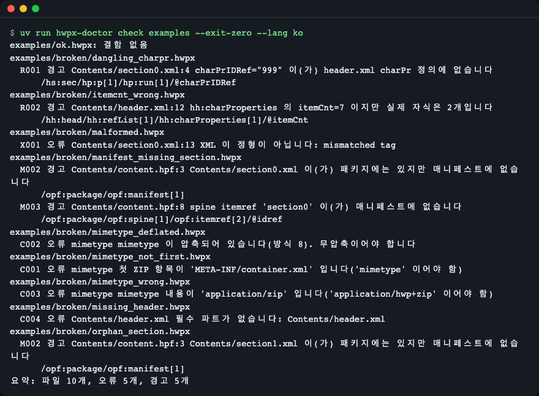
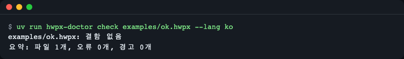
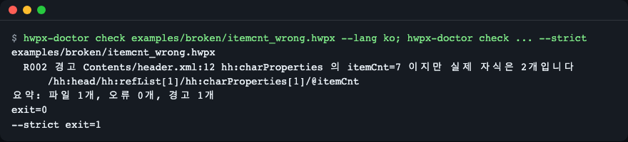
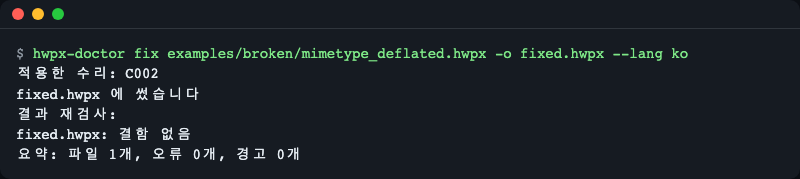
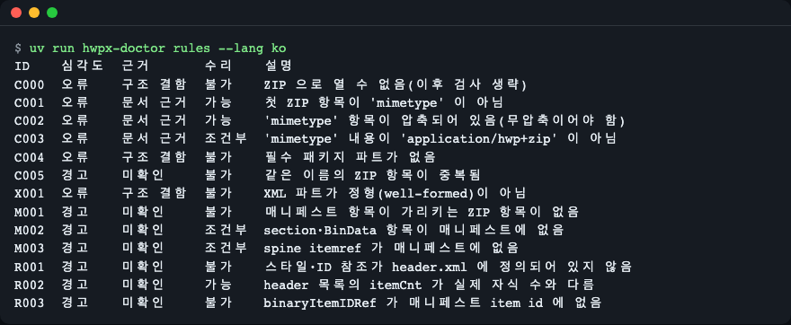
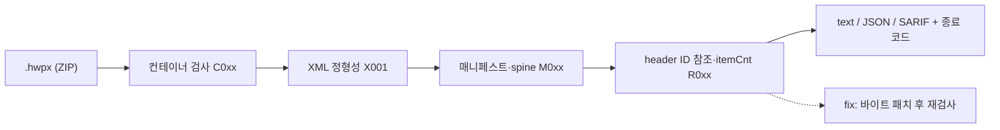

# hwpx-doctor

**한국어** | [English](README.en.md)

> **English summary** — A dependency-free CLI and Python library that checks generated HWPX (OWPML) files for container, manifest and ID-reference defects and safely repairs the mechanical ones. Use it in CI, pre-commit, or an agent loop after a converter or script writes a `.hwpx`. Install: `uv tool install git+https://github.com/LeeGyeongPil/hwpx-doctor`, run: `hwpx-doctor check out.hwpx`.

변환기나 스크립트가 만든 `.hwpx` 파일이 규격에 맞는지 한 줄로 검사하고, 의미를 바꾸지 않는 결함만 안전하게 고쳐 주는 도구입니다.


*정상 파일 1개와 손상 파일 9개를 검사한 결과. 규칙 ID, 파트:줄 번호, 요약 줄이 나옵니다.*

## 이런 분께
- HWPX 를 만드는 변환기·스크립트를 만들고, 산출물이 깨졌는지 CI 에서 자동으로 확인하고 싶은 분
- LLM·에이전트가 쓴 `.hwpx` 를 사람이 열어 보기 전에 기계적으로 걸러 내고 싶은 분
- 한컴오피스를 열지 않고 ZIP 컨테이너·매니페스트·ID 참조 문제를 줄 번호와 함께 보고 싶은 분

## 설치
```bash
# uv 가 없다면 (macOS·리눅스)
curl -LsSf https://astral.sh/uv/install.sh | sh

uv tool install git+https://github.com/LeeGyeongPil/hwpx-doctor
```
Python 3.10 이상이 필요하고, 실행 시 외부 패키지는 쓰지 않습니다(표준 라이브러리만). 라이브러리로 쓰려면 프로젝트에 `uv add git+https://github.com/LeeGyeongPil/hwpx-doctor` 또는 `pip install git+https://github.com/LeeGyeongPil/hwpx-doctor` 로 설치하고 `import hwpx_doctor` 하세요. 설치한 뒤에는 자기 파일에 `hwpx-doctor check out.hwpx` 로 바로 쓰면 됩니다.

## 빠르게 시작하기
예제 파일은 레포 안에만 있으므로 먼저 받습니다.
```bash
git clone https://github.com/LeeGyeongPil/hwpx-doctor
cd hwpx-doctor
uv run hwpx-doctor check examples --exit-zero --lang ko
```
레포의 `examples/` 에는 정상 파일 1개와 손상 파일 9개가 있습니다. 위 명령의 마지막 줄은 다음과 같습니다.
```
요약: 파일 10개, 오류 5개, 경고 5개
```
- `R001` 같은 첫 칸이 **규칙 ID**, 다음이 심각도(오류·경고), 그다음이 `파트:줄 번호` 입니다. 아래 줄은 XML 안의 위치입니다.
- `--exit-zero` 는 결함이 있어도 종료 코드를 0 으로 둡니다. 데모용이므로 붙였고, CI 에서는 빼서 실패가 전달되게 합니다.

정상 파일은 이렇게 나옵니다.


*결함이 없으면 파일 줄과 요약 줄만 나옵니다.*

## 사용법
| 명령·옵션 | 하는 일 | 예 |
|---|---|---|
| `check PATH…` | `.hwpx` 파일 또는 폴더(재귀)를 검사 | `hwpx-doctor check out.hwpx` |
| `--format text\|json\|sarif` | 출력 형식(JSON·SARIF 은 키·규칙 ID 가 언어와 무관) | `--format sarif` |
| `--select` / `--ignore` | 규칙 ID 또는 접두사로 걸러 실행 | `--select C,R001`, `--ignore R` |
| `--strict` | 경고도 실패(종료 코드 1)로 처리 | `check a.hwpx --strict` |
| `--exit-zero` | 결함이 있어도 종료 코드 0 (사용 오류는 2 유지) | `check . --exit-zero` |
| `fix IN -o OUT` | 안전한 수리 후 재검사 (`--in-place`, `--force` 도 있음) | `fix a.hwpx -o a.fixed.hwpx` |
| `rules` | 규칙 목록과 근거 수준 | `hwpx-doctor rules` |
| `--lang en\|ko` | 출력 언어 | `--lang ko` |

**종료 코드**: 0 = 실패로 칠 결함 없음, 1 = 실패로 칠 결함 있음, 2 = 사용·입력 오류(없는 경로 등).

### 시나리오 1 — 경고만 있는 파일, CI 에서 막기
`itemCnt`(목록 개수 표기)가 실제와 다른 파일입니다. 기본은 경고라 종료 코드가 0 이고, `--strict` 를 붙이면 1 이 됩니다.


*같은 파일을 기본 설정과 `--strict` 로 검사한 종료 코드 비교.*

한컴오피스에서 열리지 않는 것을 직접 확인하지 못한 규칙(근거 수준 `unverified`)은 기본이 경고입니다. 팀에서 막고 싶으면 `--strict` 를 쓰세요.

### 시나리오 2 — 기계적인 결함 고치기
`mimetype` 항목이 압축된 파일(C002)은 무압축으로 다시 담으면 됩니다. `fix` 는 입력 파일을 바꾸지 않고 새 파일을 쓴 뒤 곧바로 재검사합니다.


*수리 후 재검사에서 결함이 사라진 모습.*

참조가 끊긴 `charPrIDRef` 처럼 고치면 의미가 바뀌는 결함은 고치지 않고 "그대로 둠"으로 보고만 합니다. 같은 파일을 `fix` 한 결과를 다시 `fix` 하면 바이트가 같습니다. 출력 파일이 이미 있으면 `--force` 없이는 종료 코드 2 로 멈춥니다.

### 시나리오 3 — CI·pre-commit 에 걸기
GitHub Actions 단계 예(이 레포의 실행 검증 대상은 아니고 설정 예시입니다):
```yaml
- run: uv tool install git+https://github.com/LeeGyeongPil/hwpx-doctor
- run: hwpx-doctor check build/ --format sarif > hwpx-doctor.sarif || true
- uses: github/codeql-action/upload-sarif@v3   # code scanning 에 올리기(설정 예시, 실행 검증 안 함. 잡에 `permissions: security-events: write` 필요)
  with:
    sarif_file: hwpx-doctor.sarif
- run: hwpx-doctor check build/ --strict
```
`--format json` 출력은 (`message` 문구는 `--lang` 출력 언어를 따릅니다) 이런 모양입니다(실제 실행 결과 일부).
```json
{
  "tool": "hwpx-doctor",
  "version": "0.1.0",
  "files": [
    {
      "file": "examples/broken/malformed.hwpx",
      "findings": [
        { "rule": "X001", "severity": "error", "part": "Contents/section0.xml", "path": "", "line": 13, "message": "XML is not well-formed: mismatched tag" }
      ]
    }
  ],
  "summary": { "files": 1, "errors": 1, "warnings": 0 }
}
```
pre-commit 은 레포의 `.pre-commit-hooks.yaml` 에 훅 `hwpx-doctor` 가 정의되어 있어, 다음처럼 가져다 씁니다(설정 예시).
```yaml
repos:
  - repo: https://github.com/LeeGyeongPil/hwpx-doctor
    rev: v0.1.0
    hooks:
      - id: hwpx-doctor
```

### 시나리오 4 — 파이썬에서 부르기
공개 API: `check`, `fix`, `RULES`, `Finding`, `Report`, `FixResult`, `InputError`. 생성기 코드 안에서 이렇게 부릅니다(실행 확인).
```python
from hwpx_doctor import check

report = check("examples/broken/itemcnt_wrong.hwpx")
print([f.rule for f in report.findings])  # ['R002']
print(report.failed())                    # False (경고뿐)
print(report.failed(strict=True))         # True
```
없는 경로 등 입력 오류는 `InputError` 예외로 나옵니다.

## 설정
| 이름 | 기본 | 설명 |
|---|---|---|
| `--lang en\|ko` | 환경에서 결정 | 가장 우선 |
| `HWPX_DOCTOR_LANG` | 없음 | `en` 또는 `ko` |
| `LC_ALL` > `LC_MESSAGES` > `LANG` | 시스템 | `ko` 로 시작하지 않으면 영어 |

우선순위는 `--lang` > `HWPX_DOCTOR_LANG` > `LC_ALL` > `LC_MESSAGES` > `LANG` 입니다. 키·네트워크·설정 파일은 필요 없습니다. 모든 규칙의 목록은 다음과 같습니다.

| ID | 심각도 | 근거 수준 | 수리 | 설명 |
|---|---|---|---|---|
| C000 | 오류 | structural | 불가 | ZIP 으로 열 수 없음(이후 검사 생략) |
| C001 | 오류 | documented | 가능 | 첫 ZIP 항목이 `mimetype` 이 아님 |
| C002 | 오류 | documented | 가능 | `mimetype` 이 압축되어 있음 |
| C003 | 오류 | documented | 조건부 | `mimetype` 내용이 `application/hwp+zip` 이 아님 |
| C004 | 오류 | structural | 불가 | 필수 패키지 파트가 없음 |
| C005 | 경고 | unverified | 불가 | 같은 이름의 ZIP 항목이 중복됨 |
| X001 | 오류 | structural | 불가 | XML 파트가 정형이 아님 |
| M001 | 경고 | unverified | 불가 | 매니페스트 항목이 가리키는 ZIP 항목이 없음 |
| M002 | 경고 | unverified | 조건부 | section·BinData 항목이 매니페스트에 없음 |
| M003 | 경고 | unverified | 조건부 | spine itemref 가 매니페스트에 없음 |
| R001 | 경고 | unverified | 불가 | 스타일·ID 참조가 header.xml 에 정의되어 있지 않음 |
| R002 | 경고 | unverified | 가능 | header 목록의 `itemCnt` 가 실제 자식 수와 다름 |
| R003 | 경고 | unverified | 불가 | `binaryItemIDRef` 가 매니페스트 item id 에 없음 |


*`hwpx-doctor rules`: 규칙 13개, 근거 수준, 자동 수리 가능 여부.*

근거 수준은 `documented`(문서 근거: 공개 규격 문서에 있음), `structural`(구조 결함: 구조상 명백한 오류), `unverified`(미확인: 한컴오피스에서 열기 실패를 확인하지 못함 → 기본 경고) 세 가지입니다. 참고로 header 안의 `charPrIDRef="4294967295"`(0xFFFFFFFF)는 "참조 없음" 값으로 보고 R001 에서 제외합니다 — 실제 python-hwpx 6.12.0 산출물에서 확인한 사실입니다.

## 동작 원리

1. HWPX 는 ZIP 이며 첫 항목은 무압축 `mimetype` 이어야 합니다(C001~C003).
2. 모든 XML 파트가 정형인지 expat 으로 확인하고 줄 번호를 기록합니다(X001).
3. `content.hpf`(OPF 컨테이너)의 매니페스트와 spine 이 실제 파트와 양방향으로 맞는지 봅니다(M001~M003).
4. `header.xml` 의 ID 참조와 `itemCnt` 가 실제 정의와 맞는지 봅니다(R001~R003). 네임스페이스는 접두사가 아니라 URI 로 매칭합니다.
5. `fix` 는 XML 을 다시 쓰지 않고 숫자·닫는 태그 앞 같은 바이트만 패치해 나머지 바이트를 그대로 둡니다.

## 언제 쓰나
- 이럴 때: 여러 생성기·스크립트가 만든 `.hwpx` 를 CI 에서 같은 규칙으로 점검하고 싶을 때, 외부 의존 없이 한 줄로 걸고 싶을 때.
- 범위: 컨테이너·매니페스트·header ID 참조 검사와 기계적 수리만 합니다. 본문 서식·렌더링 결과는 검사하지 않으며, 한컴오피스에서 실제로 열리는지는 보장하지 않습니다(대부분 규칙이 `unverified`). 7개 변형은 python-hwpx 6.12.0 로 만든 문서로 확인했고 다른 생성기는 아직 대조하지 않았습니다.
- 이럴 땐 다른 도구: HWPX 를 만들거나 편집 → [python-hwpx](https://github.com/airmang/python-hwpx), 읽어서 텍스트로 변환 → 해당 파서 도구를 쓰세요. 이 도구는 만들어진 결과를 점검합니다.

## 기존 도구와 함께 쓰기
처음 나온 HWPX 검사기가 아닙니다. 이미 있는 도구가 하는 일은 그대로 두고, 그 도구들이 종료 코드로 걸러 주지 않던 부분(참조 무결성·`itemCnt`·매니페스트 양방향)을 채우는 용도입니다. 아래는 python-hwpx 6.12.0 로 만든 정상 문서에 손상 7가지를 만들어 각 도구를 돌려 본 결과입니다(2026-11-16 확인, 종료 코드 기준).

| 손상 | hwpx-doctor | python-hwpx `hwpx-validate-package` | python-hwpx `hwpx-validate`(XSD) | pyhwpxlib 0.18.3 `validate` |
|---|---|---|---|---|
| mimetype 이 첫 항목 아님 | C001 | 오류(종료 1) | 통과(0) | 통과(0) |
| mimetype 압축됨 | C002 | 오류(1) | 통과(0) | 통과(0) |
| XML 깨짐 | X001 | 오류(1) | 종료 1(트레이스백) | 종료 1 |
| charPrIDRef 끊김 | R001 | 통과(0) | 통과(0) | 통과(0) |
| itemCnt 불일치 | R002 | 통과(0) | 통과(0) | 통과(0) |
| 매니페스트에 없는 section | M002 | 통과(0) | 통과(0) | 통과(0) |
| 매니페스트에서 section0 제거 | M002+M003 | 경고만(0) | 통과(0) | 통과(0) |

출처: [python-hwpx](https://github.com/airmang/python-hwpx), [pyhwpxlib (PyPI)](https://pypi.org/project/pyhwpxlib/). python-hwpx 는 `check_id_integrity` API 로 ID 참조 검사를 제공하지만 CLI 로는 노출되지 않습니다. 이 표는 저 7가지 입력에 대한 결과이며 도구 전체 기능을 비교한 것이 아닙니다. 각 도구는 버전에 따라 달라질 수 있으니 직접 확인하세요.

함께 쓰는 법: 생성·편집과 XSD 검증은 python-hwpx 에 맡기고, 산출물의 구조·참조 무결성 게이트는 hwpx-doctor 로 겁니다. pyhwpxlib 는 비상업 라이선스(PolyForm-Noncommercial-1.0.0 AND Apache-2.0)이므로 회사 CI 에 넣기 전에 라이선스를 확인하세요. [hwpxskill](https://github.com/canine89/hwpxskill) 의 `validate.py` 는 매니페스트→ZIP 한 방향만 봅니다.

재현(실제 실행 출력의 일부, 레포 clone 안에서):
```bash
uv run --with python-hwpx==6.12.0 python scripts/interop_python_hwpx.py
```
```
ok.hwpx: 0 findings
mimetype_not_first.hwpx: ['C001'] (expected ['C001']) ok
...
manifest_missing_section.hwpx: ['M002', 'M003'] (expected ['M002', 'M003']) ok
detected 7/7
```

## 한계
- 구조 검사를 통과해도 한컴오피스에서 똑같이 열리고 보인다는 뜻은 아닙니다. 참고로 python-hwpx README 는 생성한 476개 파일이 한글 2024 에서 열기 476/476, 렌더 확인 416/476 이라고 밝힙니다.
- 한컴오피스를 직접 돌려 보지 못해, `C001`~`C004`·`X001` 외 규칙은 실제 열기 실패를 확인하지 못했습니다(그래서 기본 경고).
- 규칙은 KS X 6101 원문이 아니라 공개 XSD 와 실제 생성 파일 관찰에 근거합니다. 연동 확인은 python-hwpx 6.12.0 한 가지뿐입니다.
- `encoding="EUC-KR"` 처럼 멀티바이트 인코딩을 선언한 XML 파트는 해석하지 않고 X001 로, "지원하지 않는 인코딩 선언 — UTF-8 로 저장하세요" 취지로 보고합니다. 상세 사유 문구(expat 오류 등)는 `--lang ko` 에서도 영어로 나옵니다.

## 자주 겪는 문제
| 증상 | 원인 | 해결 |
|---|---|---|
| 경고만 있는데 종료 코드가 0 | 기본은 경고를 실패로 치지 않음 | `--strict` 사용 |
| CI 가 실패해야 하는데 항상 통과 | `--exit-zero` 가 붙어 있음 | 해당 옵션 제거 |
| `.hwpx 파일이 하나도 없습니다` 와 종료 코드 2 | 폴더에 `.hwpx` 가 없음(경로 오타, 생성 단계 실패) | 경로와 생성기 출력을 확인 |
| 종료 코드 2 와 `fix` 오류 | 출력 파일이 이미 있거나 경로가 없음 | `--force` 또는 올바른 경로 |
| `usage:`·`options:` 가 영어로 나옴 | argparse 표준 문구는 언어와 무관 | 정상 동작, 나머지 설명은 `--lang` 을 따름 |
| 오류 없는데 한컴오피스에서 안 열림 | 규칙 대부분이 열기 확인 전(`unverified`) | 이슈로 파일 구조(민감 내용 제외)를 알려 주세요 |

## 개발·기여
```bash
uv run pytest -q
```
버그·제안은 이슈로 남겨 주세요. 변경 기록은 [CHANGELOG.md](CHANGELOG.md).

## 라이선스
MIT. 런타임 의존성이 없어 별도 모델·데이터 라이선스는 없습니다.
